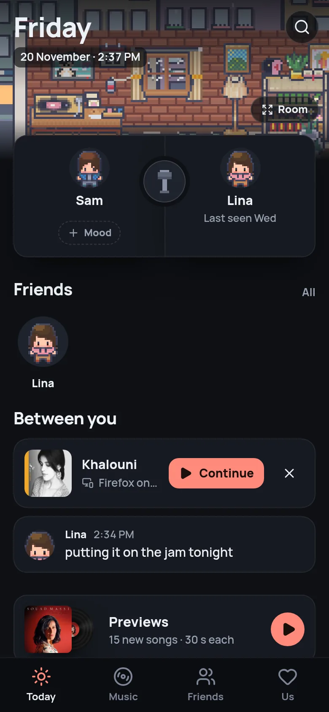
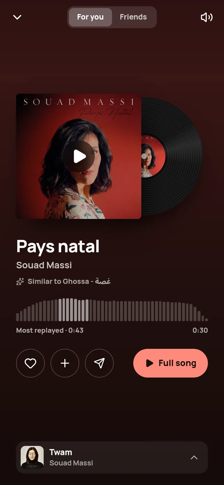
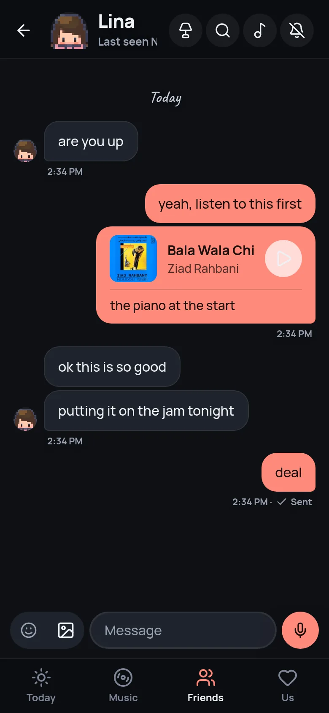
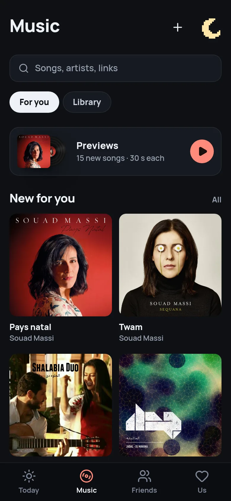
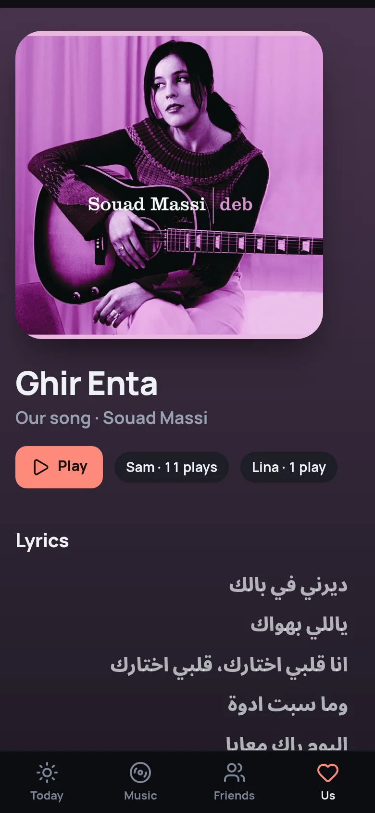
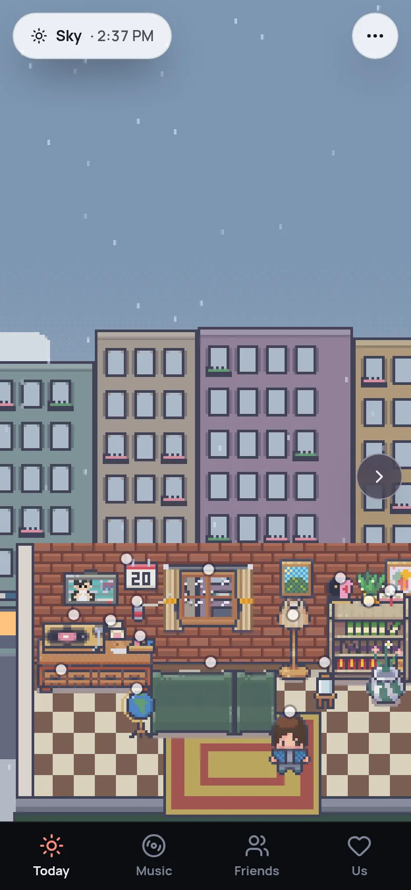

demo credentials: demo:demo-qbzd-4rdn-wt5p

# Jobbos

A music app I made for my partner as a sorry gift :P

It pulls songs from youtube music, and has some cool features!

  
  
  

  
  
  

## What it does

- search youtube, yt music, and soundcloud (supports direct links)
- import playlists from spotify (through [Exportify](https://exportify.app))
- synced lyrics
- offline downloads
- previews: 30-seconds feed of music suggestions
- recommendations based on what you listen to
- chat with song and lyric cards, voice notes and photos
- jams
- a pixel room that changes with the time of day and the weather
- letters, memories on a map, listening stats, and a page for our song

## Credits

Room furniture and characters are from LimeZu's
[Modern Interiors](https://limezu.itch.io/moderninteriors) (free version, non-commercial).
Weather by [Open-Meteo](https://open-meteo.com), IP geolocation by
[DB-IP](https://db-ip.com), map data © [OpenStreetMap](https://www.openstreetmap.org/copyright)
contributors.
